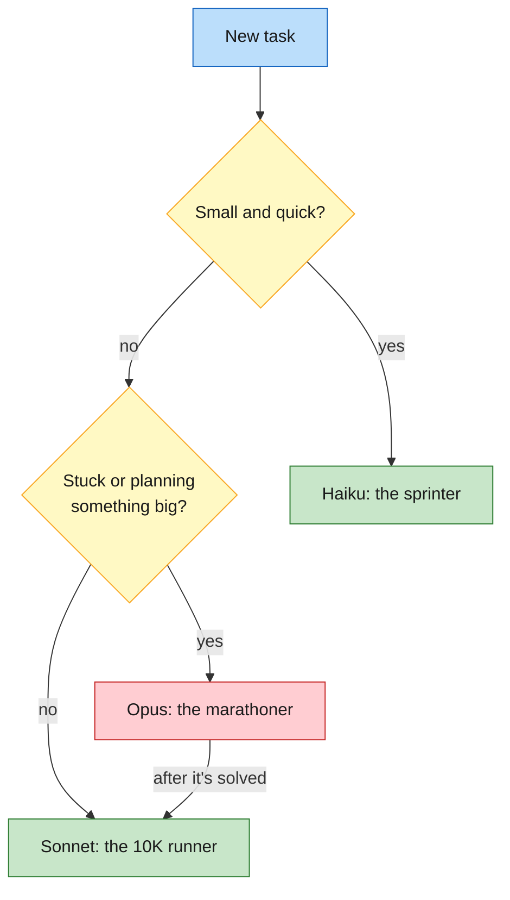
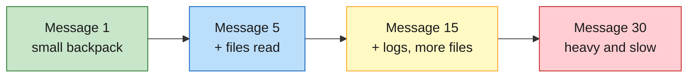

# Claude models and the token race

## What you will learn

- How the Claude models in Claude Code differ, using runners as the picture
- What a token is, and why your conversation gets more expensive with every message
- Habits that stretch your usage limit across a full day of Laravel labs
- How to check how much you have used, inside VS Code

## Why this matters today

Today's labs are prompt-heavy. You will ask Claude Code to write routes, controllers, services and views many times. Every account has a usage limit, and when you hit it, Claude stops answering until the limit resets. That can happen in the middle of a lab, while the people around you keep going.

There is no unli rice here: tokens are rationed. Most people who run out early make the same few mistakes, and the habits below avoid them.

## The runners: which model is which

Claude Code can use several models. Think of them as runners in a fun run around Quezon Memorial Circle. They are all on the same team, but they move differently and they eat differently.

| Runner | Model alias | Good at | Eats |
|---|---|---|---|
| The sprinter | `haiku` | Fast, short, simple jobs: explain an error, rename a variable, write one small function | Little |
| The 10K runner | `sonnet` | Everyday coding: a controller, a migration, a Blade view, fixing a bug in one or two files | Medium |
| The marathoner | `opus` | Hard thinking: planning an app's structure, a bug you have been stuck on for 20 minutes | A lot |
| The ultramarathoner | `fable` | The hardest, longest jobs (only where your plan offers it) | The most |

The bigger runners think more carefully, and they cost more for every step. Sending the marathoner to buy pandesal at the corner store works, but you burn a marathoner's breakfast on a two-minute errand. Do that twenty times and the marathoner is too tired for the real race.

The sprinter has the opposite problem. It is quick and cheap, but give it a long, tangled job (for example, "build the whole report card feature across six files") and it can lose its way halfway around the track. Then you spend more tokens fixing its work.


On most plans, Claude Code starts on the **marathoner** (Opus) by default. So unless you change it, every small question you ask uses the most expensive runner. Check your model before the labs start.


### A simple rule for today

- Use **Sonnet** for the Laravel labs. It handles normal coding well and costs less than Opus.
- Switch to **Haiku** for quick questions: "what does this error mean?", "explain this line", "fix this typo".
- Switch to **Opus** only when you are truly stuck or planning something big. Then switch back.



Follow the green paths for most of your work. The red box is allowed, but treat it as a short visit.

### How to switch models

In the **VS Code panel**, click the model name at the bottom of the prompt box, or type `/` and choose **Switch model…**. The same picker has an **Effort** row. Lower effort means Claude thinks less before answering, which saves tokens on easy tasks.

In the **terminal** (run `claude` in VS Code's terminal), use:

```text
/model sonnet
/model haiku
/model opus
/effort low
```

`/model` on its own opens a picker. Typing `/model sonnet` switches straight away and saves it as your default. `/effort` takes `low`, `medium`, `high`, `xhigh` or `max`.

## What a token is

Claude does not read words. It reads **tokens**, which are small chunks of text. In English, a token is roughly three quarters of a word. Code uses more tokens than plain English, because symbols like `->`, `{`, `$` and `;` each take space.

Everything counts as tokens:

- Your prompt
- Every file Claude opens
- Every command output Claude reads (a 300-line error log is a lot of tokens)
- Claude's thinking before it answers
- Claude's reply
- Your `CLAUDE.md`, which loads at the start of every conversation

## Why long conversations get expensive: the backpack

Claude has no memory between messages. Each time you send a message, Claude Code sends the **whole conversation so far** along with it, so Claude can see what happened before.

Picture your runner carrying a backpack of baon. Every message adds more to the backpack: your question, the files Claude opened, the answer. The runner never puts anything down. By message 30, they are jogging with rice, ulam, three bottles of water and yesterday's leftover pancit, and every step costs more energy than the last.



Read it left to right: the same short question costs more at message 30 than at message 1, because the whole backpack travels with it.

Claude Code does reuse the parts it has already seen (this is called caching), so repeated parts cost less. But the cache expires after a while. Come back from lunch and send one more message in a huge old conversation, and the whole backpack gets loaded again at full price.

When the backpack gets close to full, Claude Code **compacts** it automatically: it writes a summary of the conversation and drops the details. That keeps you running, but the summary itself costs tokens, and some details get lost.

| In the story | In Claude Code |
|---|---|
| The runner | The model (Haiku, Sonnet, Opus) |
| Energy for the day | Your usage limit |
| The backpack | The context (the whole conversation so far) |
| Each item of baon | A prompt, a file read, a log, a reply |
| Dropping the backpack and starting fresh | A new conversation (`/clear`) |
| Repacking into one small bag | `/compact` |
| A bigger runner eating more per km | Opus costs more per token than Sonnet or Haiku |

## Habits that save tokens

### 1. One task, one conversation

When you finish a task and move to an unrelated one, start a fresh conversation. Your new task does not need the backpack from the old one.

- **VS Code panel:** open the Command Palette (`Ctrl+Shift+P`) and run **Claude Code: Open in New Tab**. Old conversations stay in **Session history** at the top of the panel if you need them again.
- **Terminal:** type `/clear`. It starts a new conversation with empty context, and it costs nothing.

Lab 4 is done and you are starting Lab 5? New conversation.

### 2. Compact when you need to keep going on the same task

If you are halfway through a task and the conversation is long, compact it instead of starting over:

```text
/compact keep the ReportCardService changes and the failing test
```

The text after `/compact` tells Claude what to keep in the summary. Compacting a big conversation is itself a big request, so do it once at a good stopping point, not every few messages.

### 3. Name the exact files

A vague prompt sends Claude exploring. It opens file after file, and every file goes in the backpack.

| Costs a lot | Costs little |
|---|---|
| "Why is my report card page broken?" | "In `@app/Services/ReportCardService.php`, `generalAverage()` returns 0. Find why." |
| "Make the app look better" | "In `@resources/views/cards/show.blade.php`, put the grades in a table with a border." |
| "Fix the error" | "Running `php artisan migrate` gives this error: (paste the last 10 lines). Fix the migration." |

Type `@` in the VS Code prompt box and start typing a file name to attach it. `@app/Services/` with a slash attaches a folder.

### 4. Paste only the part that matters

A full Laravel error page or a 500-line log is mostly noise. Paste the error message and the few lines around it. If you are not sure which part matters, paste the top 15 lines first.

### 5. Do not make Claude re-read huge files

Asking "check the whole project again" or attaching `vendor/` or `storage/logs/laravel.log` fills the backpack fast. Point at the one file you changed. If you need a quick fact about a big file, ask for just that ("in `routes/web.php`, which route uses `ReportCardController@show`?").

### 6. Keep CLAUDE.md short

`CLAUDE.md` loads at the start of **every** conversation. Every line in it is baon you pack for every run. The Claude Code docs suggest keeping it under about 200 lines. Put in only the rules Claude really needs, such as "controllers only call services" and "use MariaDB", and leave out long explanations.

### 7. Ask side questions on the side

Want to ask "what is a facade again?" in the middle of a task? In the VS Code panel, type `/btw` and your question. It opens a side panel and the answer does not get added to your main conversation.

### 8. Pick the right runner and the right effort

Use the model rule from above. For an easy job, set effort to low. Claude's thinking counts as tokens too, and on a simple rename there is nothing to think hard about.

### 9. Read before you re-prompt

When Claude's answer is wrong, do not just type "no, fix it" five times. Each retry adds to the backpack. Read the code, find what is wrong, and tell Claude specifically: "the average should skip subjects with no grade yet".

## Check your fuel

You can see how much you have used.

- **`/usage`** (works in the VS Code panel and the terminal) opens your plan usage bars, so you can see how close you are to your limit and when it resets. In the terminal, `/cost` and `/stats` open the same screen.
- **Context indicator:** the VS Code prompt box shows how full the current conversation is.
- **`/context`** (terminal) draws a colored grid of what is filling your context: your conversation, `CLAUDE.md`, tools and so on.


Not every command is available in the VS Code panel. If you type a command and nothing happens, open VS Code's terminal, run `claude`, and try it there.


## Survive the token race: checklist

Run through this before each lab.

- [ ] I checked my model. It is Sonnet for the lab, not Opus by accident.
- [ ] I started a new conversation for this lab.
- [ ] My prompt names the exact files with `@`.
- [ ] I pasted only the useful part of any error.
- [ ] My `CLAUDE.md` is short and only has real rules.
- [ ] I use Haiku and low effort for quick questions, or `/btw` for side questions.
- [ ] I switch to Opus only when stuck, and switch back after.
- [ ] I read Claude's answer before asking it to try again.
- [ ] I checked `/usage` at lunch and know how much I have left.
- [ ] After a long break, I start a fresh conversation for new work instead of reviving a huge old one.

## Practice task (10 minutes)

You will see the backpack grow with your own eyes.

1. Type `/usage` and note where your usage bar is now.
2. Open a new conversation. Make sure the model is **Sonnet**.
3. Send a vague prompt: `Explain how my report card app works.` Watch the context indicator as Claude opens files.
4. Open another new conversation. Switch the model to **Haiku** and set effort to low.
5. Send a focused prompt: `In @app/Services/ReportCardService.php, explain what remark() does in 3 lines.`
6. Compare the context indicator for the two conversations.
7. Switch the model back to **Sonnet** for the next lab.


Expected result: the vague conversation is much fuller after one message, because Claude had to read many files. The focused one stays small.


If you do not have the report card app yet, use any file from today's lab in step 5.

## Check your understanding

<details>
<summary>1. You have asked 40 messages in one conversation about the controller lab. Now you want to start the views lab. What do you do?</summary>

Start a new conversation (new tab in VS Code, or `/clear` in the terminal). The views lab does not need 40 messages of controller history in the backpack.
</details>

<details>
<summary>2. Why does a short question cost more at message 30 than at message 1?</summary>

Because every message sends the whole conversation so far along with it. At message 30 the backpack holds everything from the first 29 messages.
</details>

<details>
<summary>3. You want to know what <code>Route::resource</code> does. Which model would you use, and why?</summary>

Haiku, with low effort, or a `/btw` side question. It is a short factual question. Opus would answer it well too, but you would spend a marathoner's energy on a corner-store errand.
</details>

## Official docs

- [Manage costs effectively](https://code.claude.com/docs/en/costs): what uses tokens, `/usage`, `/compact`, `/clear`, and the advice on `CLAUDE.md` size.
- [Model configuration](https://code.claude.com/docs/en/model-config): the model aliases, `/model` and effort levels.
- [Claude Code in VS Code](https://code.claude.com/docs/en/vscode): switching models, new tabs, `@` file mentions and `/btw` in the extension.
- [Commands](https://code.claude.com/docs/en/commands): the full list of slash commands.
