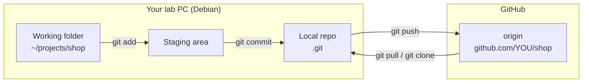
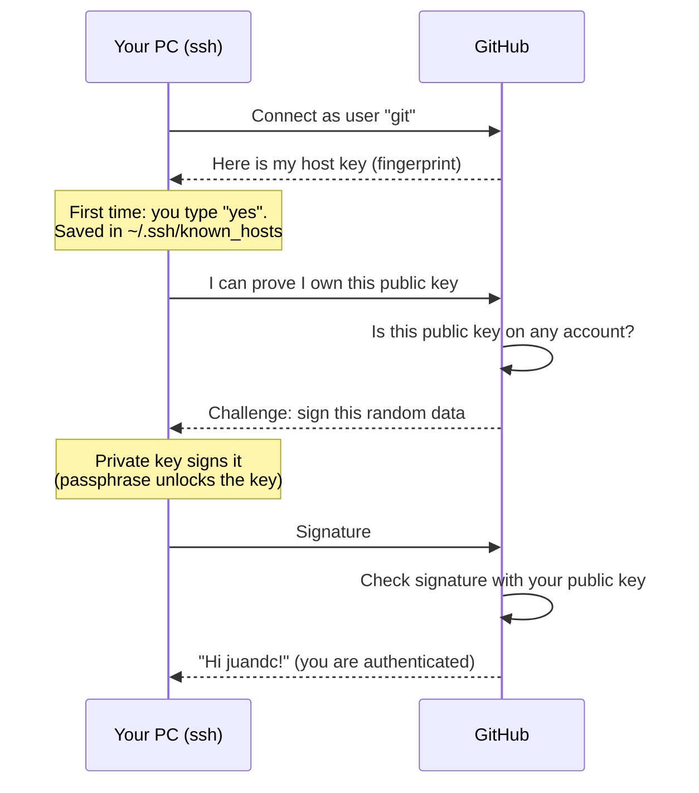
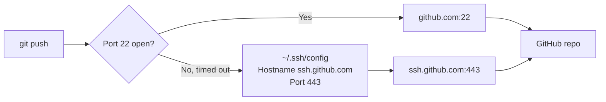
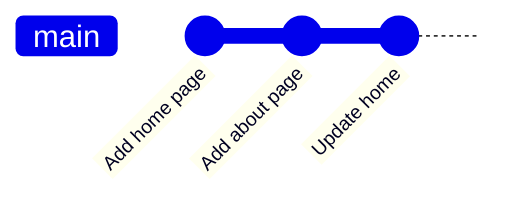
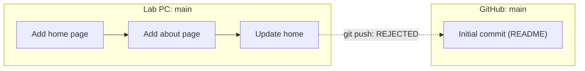
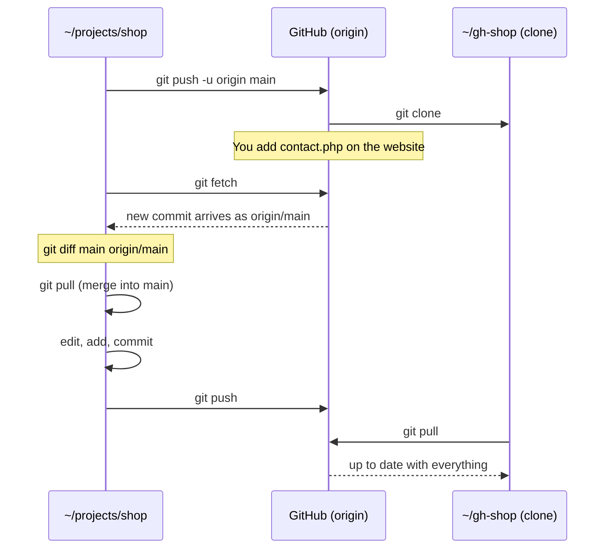
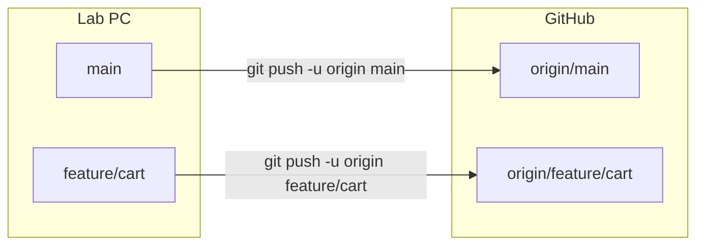
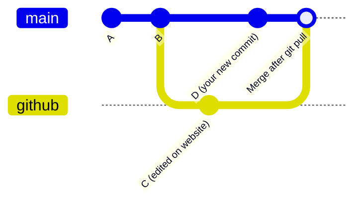

# Lab: Push your Git repo to GitHub

**Day 1 · Git · continues from G3 (History, diff, undo)**
**Machine:** Debian 13, user `student` · **Project:** `~/projects/shop`
**Time:** about 40 minutes

You already have a Git repository on your lab PC: `~/projects/shop`, with `index.php`, `about.php` and at least three commits. You used `git log`, `git diff` and `git restore` on it in G3. So far, all of that history lives only on this one machine.

In this lab you put that same repository on GitHub. When you finish you will have:

- an SSH key that proves to GitHub who you are
- an empty GitHub repository that receives your commits
- your local repo connected to it as `origin`
- a pushed `main` branch, and a clone that proves the round trip works

---

## The big picture



Everything on the left you have done already (G2 and G3). This lab adds the arrows to the right.

Two things are new compared with working locally:

1. **GitHub needs proof of who you are.** Your `user.name` and `user.email` are only labels written inside each commit. Anyone can type any name. The proof is an **SSH key** (or a personal access token over HTTPS).
2. **The remote has an internet address**, like `git@github.com:juandc/shop.git`.

The commands `push`, `pull` and `clone` are the same ones you would use with any remote.

---

## Step 0: Check where you are

```bash
cd ~/projects/shop
git status
git log --oneline
git remote -v
```

What to expect:

| Command | You should see |
|---|---|
| `git status` | `nothing to commit, working tree clean`. If not, commit or restore first (G3). |
| `git log --oneline` | 3 or more commits |
| `git remote -v` | **Nothing** (most likely), or `origin /home/student/remotes/shop.git` if you already did the folder-remote lab. Write down which. You need it in Step 5. |

> If `~/projects/shop` doesn't exist, rebuild it quickly:
> ```bash
> mkdir -p ~/projects/shop && cd ~/projects/shop && git init
> echo "<h1>PSHS Shop</h1>" > index.php && git add . && git commit -m "Add home page"
> echo "<h1>About</h1>" > about.php && git add . && git commit -m "Add about page"
> ```

---

## Step 1: Check your Git identity

Every commit you push will show this name and email on GitHub, permanently.

```bash
git config --global user.name
git config --global user.email
```

If either prints nothing, set it:

```bash
git config --global user.name "Juan Dela Cruz"
git config --global user.email "juan@pshs.edu.ph"
```

Use the **same email as your GitHub account**. GitHub links a commit to your profile (photo, name, contribution graph) only when the emails match. If they don't, the commit still uploads but shows a grey avatar.

> **Privacy option:** on GitHub open **Settings › Emails**, tick *Keep my email addresses private*, and use the address it shows, for example `12345678+juandc@users.noreply.github.com`.

**Note:** the commits you already made keep the old name and email. Only new commits use the new setting. That's fine for this lab.

---

## Step 2: Make an SSH key

An SSH key is a pair of files:

- **Private key** `~/.ssh/id_ed25519`: stays on this PC. Never share it, never paste it anywhere, never commit it.
- **Public key** `~/.ssh/id_ed25519.pub`: you give this one to GitHub.

Think of the public key as an open padlock you can hand out to anyone, and the private key as the only key that opens it.

```bash
ssh-keygen -t ed25519 -C "juan@pshs.edu.ph"
```

1. `Enter file in which to save the key`: press **Enter** to accept `/home/student/.ssh/id_ed25519`.
2. `Enter passphrase`: type one and press Enter, then type it again. Nothing shows while you type; that is normal. On a shared lab PC, **do set a passphrase**: if someone copies your key file, they still can't use it without it.
3. If you see `id_ed25519 already exists. Overwrite (y/n)?` answer **n**. A key is already there; use it.

Check the files and show the public key:

```bash
ls -l ~/.ssh
cat ~/.ssh/id_ed25519.pub
```

The output is **one long line** that starts with `ssh-ed25519` and ends with your email. Select and copy the whole line.

| Option | Meaning |
|---|---|
| `-t ed25519` | Key type. Short, fast, and what GitHub recommends. |
| `-C "..."` | A comment on the end of the public key so you can recognise it later. |

---

## Step 3: Add the public key to GitHub

In the browser, signed in to GitHub:

1. Click your avatar (top right) › **Settings**.
2. Left menu: **SSH and GPG keys** › **New SSH key**.
3. **Title:** name the machine, for example `PSHS lab PC 14`.
4. **Key type:** Authentication Key.
5. **Key:** paste the whole `ssh-ed25519 ...` line.
6. Click **Add SSH key** (GitHub may ask for your password or a 2FA code).

Naming keys by machine pays off later. When the lab PCs are reimaged, you delete *PSHS lab PC 14* and your laptop's key keeps working.

---

## Step 4: Test the connection

```bash
ssh -T git@github.com
```

The first time, SSH asks:

```text
The authenticity of host 'github.com' can't be established.
ED25519 key fingerprint is SHA256:+DiY3wvvV6TuJJhbpZisF/zLDA0zPMSvHdkr4UvCOqU.
Are you sure you want to continue connecting (yes/no/[fingerprint])?
```

That fingerprint is GitHub's real one. Type **yes**, then enter your passphrase. Success looks like this:

```text
Hi juandc! You've successfully authenticated, but GitHub does not provide shell access.
```

"Does not provide shell access" sounds like an error. It isn't. It means the key works; GitHub just doesn't give you a terminal on its servers.

### What just happened



Your private key never leaves your PC. GitHub only checks a signature made with it.

### If it hangs and then says "Connection timed out"

Many campus and office networks block port 22, which SSH normally uses. GitHub also accepts SSH on port **443** (the normal HTTPS port), which is almost never blocked.

```bash
nano ~/.ssh/config
```

Paste this, then save with `Ctrl+O`, `Enter`, `Ctrl+X`:

```text
Host github.com
    Hostname ssh.github.com
    Port 443
    User git
```

```bash
chmod 600 ~/.ssh/config
ssh -T git@github.com
```

The first time over 443 you may be asked about the host key again; answer **yes**. Your remote URL stays `git@github.com:...`; SSH quietly redirects it.



### Alternative: HTTPS with a personal access token

Use this only if SSH is fully blocked or you can't get the key working in time.

Your **GitHub password does not work** for `git push`. Since August 2021 GitHub rejects it with *Password authentication is not supported for Git operations*. You need a token instead.

1. GitHub **Settings › Developer settings › Personal access tokens › Fine-grained tokens › Generate new token**.
2. **Expiration:** 7 days.
3. **Repository access:** Only select repositories › `shop` (create the repo in Step 5 first).
4. **Permissions › Repository permissions › Contents:** Read and write.
5. **Generate**, then copy the token right away. GitHub shows it only once.

Then, in Step 6 use the HTTPS URL instead of the SSH one:

```bash
git remote set-url origin https://github.com/YOUR-USERNAME/shop.git   # or "remote add" if no origin
git config --global credential.helper 'cache --timeout=3600'
git push -u origin main
# Username: your GitHub username
# Password: paste the TOKEN (nothing shows while you paste)
```

`credential.helper cache` remembers the token in memory for one hour so you don't paste it on every push.

---

## Step 5: Create an empty repository on GitHub

1. On GitHub, click **+** (top right) › **New repository**.
2. **Repository name:** `shop`
3. **Private** or Public: your choice. Private is fine.
4. **Do not tick** *Add a README*, *.gitignore*, or *license*. Leave everything empty.
5. Click **Create repository**.
6. On the *Quick setup* page, click **SSH** and copy the address:
   `git@github.com:YOUR-USERNAME/shop.git`

### Why it must be empty



That is your history on the lab PC. If you tick *Add a README*, GitHub creates its own first commit, with no connection to yours. Now there are two separate histories that share nothing:



Git refuses the push, and a pull says *refusing to merge unrelated histories*. It's fixable (see Troubleshooting), but an empty repo avoids it entirely.

---

## Step 6: Connect your project to GitHub

```bash
cd ~/projects/shop
git remote -v
```

**Case A: `git remote -v` prints nothing** (you haven't done the folder-remote lab):

```bash
git remote add origin git@github.com:YOUR-USERNAME/shop.git
```

**Case B: origin already points at a folder** like `/home/student/remotes/shop.git`:

```bash
git remote set-url origin git@github.com:YOUR-USERNAME/shop.git
```

Or, to keep the folder remote as well, rename it and add GitHub as the new origin:

```bash
git remote rename origin lab
git remote add origin git@github.com:YOUR-USERNAME/shop.git
```

Check:

```bash
git remote -v
```

```text
origin  git@github.com:juandc/shop.git (fetch)
origin  git@github.com:juandc/shop.git (push)
```

| Command | What it does |
|---|---|
| `git remote -v` | List remotes with their URLs |
| `git remote add NAME URL` | Create a new remote. Fails if the name exists. |
| `git remote set-url NAME URL` | Change the address of an existing remote |
| `git remote rename OLD NEW` | Rename a remote |

**Watch out:**
- Replace `YOUR-USERNAME` with your real GitHub username. Copying it literally is the most common mistake in this lab.
- The SSH address has a **colon** after `github.com`, not a slash: `git@github.com:juandc/shop.git`.

A remote is only a nickname and an address saved in `.git/config`. You can see it:

```bash
cat .git/config
```

---

## Step 7: Push

```bash
git branch -M main
git push -u origin main
```

| Part | Meaning |
|---|---|
| `git branch -M main` | Rename the current branch to `main`. Does nothing if it already is `main` (you set `init.defaultBranch main` in G1). Needed only if yours is still `master`. |
| `-u` | Short for `--set-upstream`. Links your local `main` to `origin/main`, so later plain `git push` and `git pull` know where to go. Only needed on the first push of a branch. |
| `origin main` | Push the `main` branch to the remote called `origin`. |

Refresh your repo page on GitHub. Your files are there. Click **commits**: the same messages and IDs you saw in `git log --oneline`, with your name.

```bash
git status
```

```text
On branch main
Your branch is up to date with 'origin/main'.
```

---

## Step 8: Prove the round trip

### 8a. Clone it into a new folder

```bash
cd ~
git clone git@github.com:YOUR-USERNAME/shop.git gh-shop
cd gh-shop
ls
git log --oneline
```

Same files, same commit IDs as `~/projects/shop`. A clone contains the **whole history**, not just the latest files.

### 8b. Change something on GitHub and pull it down

1. On your GitHub repo page: **Add file › Create new file**.
2. Name: `contact.php`. Content: `<h1>Contact us</h1>`.
3. Click **Commit changes**.

Back in the terminal:

```bash
cd ~/projects/shop
git status           # still says "up to date": it hasn't checked GitHub
git fetch
git status           # now: "behind 'origin/main' by 1 commit"
git log --oneline --all
git diff main origin/main
git pull
ls
```

You just used your G3 tools (`log`, `diff`) to inspect a commit **before** bringing it in.

### 8c. Push a change from the terminal

```bash
echo "<p>Open Mon to Fri, 7:30 to 4:30</p>" >> contact.php
git add contact.php
git commit -m "Add opening hours"
git push
```

No `-u` this time. Refresh GitHub to see it.

### The full cycle



---

## Step 9 (optional): Push your branches

`git push -u origin main` sends only `main`. Other branches, such as `feature/cart` from the branching lab, stay on your PC until you push them by name.

```bash
git branch                       # local branches
git push -u origin feature/cart  # one branch
git push origin --all            # every local branch
git branch -r                    # branches your repo knows are on GitHub
```

On GitHub, open the branch dropdown (it says **main**) to see them.



**Table bonus:** add a tablemate as a collaborator (**Settings › Collaborators › Add people**). They accept the invite by email, clone your repo, commit a new file and push. You run `git pull`. If you both push at the same time, one of you gets *rejected*: `git pull`, then `git push` again.

---

## Troubleshooting

Read the **first line** of the error. It usually tells you which of these it is.

For any SSH problem, run the test with `-v` (verbose):

```bash
ssh -vT git@github.com
```

Look for `Offering public key: /home/student/.ssh/id_ed25519`. Missing means SSH isn't finding your key. Present but still refused means the key on GitHub doesn't match the key on this PC.

| Error | Cause | Fix |
|---|---|---|
| `Permission denied (publickey)` | GitHub doesn't recognise your key. | Compare `cat ~/.ssh/id_ed25519.pub` with the key on GitHub (whole line). Check you added it to **your** account, not a tablemate's. Re-run `ssh -T git@github.com`. |
| `Connection timed out` / `port 22` | Network blocks SSH. | Add the port 443 config from Step 4, or use HTTPS with a token. |
| `Password authentication is not supported for Git operations` | You typed your GitHub password over HTTPS. | Paste a personal access token as the password, or switch the remote to SSH. |
| `! [rejected] main -> main (fetch first)` | GitHub has commits you don't have (someone pushed, or you edited on the website). | `git pull`, close nano with `Ctrl+X` if it opens, then `git push`. **Never** `--force` on a shared repo. |
| `! [rejected] main -> main (non-fast-forward)` | Same cause, different wording. | Same fix: `git pull`, then `git push`. |
| `fatal: refusing to merge unrelated histories` | The GitHub repo was created **with** a README. | `git pull origin main --allow-unrelated-histories`, save the merge message, then `git push -u origin main`. Or delete the GitHub repo and recreate it empty. |
| `ERROR: Repository not found` / `does not appear to be a git repository` | Wrong URL: username, repo name, or slash instead of colon. | `git remote -v`, then `git remote set-url origin git@github.com:USERNAME/shop.git`. |
| `error: remote origin already exists` | You used `add` but origin is already set. | Use `git remote set-url origin ...` instead. |
| `error: src refspec main does not match any` | No commits yet, or your branch has another name. | `git log` and `git branch`. Commit something, or `git branch -M main`. |
| `Host key verification failed` | You answered *no* to the fingerprint question, or `known_hosts` has an old entry. | `ssh-keygen -R github.com`, then `ssh -T git@github.com` and answer **yes**. |

### Why a push gets rejected



GitHub has `C`, you have `D`. Git won't let your push throw `C` away, so it rejects. `git pull` merges `C` into your branch, then `git push` succeeds.

---

## Check yourself

1. You see `Permission denied (publickey)`. Does changing `git config user.email` help? *(No. SSH login uses only the key.)*
2. Which file must never be pasted into GitHub: `id_ed25519` or `id_ed25519.pub`? *(`id_ed25519`, the private key.)*
3. Your origin points at `~/remotes/shop.git`. Which is faster: `git remote add origin ...` or `git remote set-url origin ...`? *(`set-url`. `add` fails because origin exists.)*
4. Right after someone edits the repo on GitHub, `git status` says "up to date". Why? *(Status compares with `origin/main`, your last downloaded view. Run `git fetch` first.)*
5. Why do you create the GitHub repo without a README? *(So GitHub's history is empty and your push fills it, instead of two unrelated histories.)*

---

## Cheat sheet

```bash
# once per machine
git config --global user.email
ssh-keygen -t ed25519 -C "you@example.com"
cat ~/.ssh/id_ed25519.pub        # paste into GitHub › Settings › SSH and GPG keys
ssh -T git@github.com

# once per project
git remote -v
git remote add origin git@github.com:USERNAME/shop.git      # no origin yet
git remote set-url origin git@github.com:USERNAME/shop.git  # origin exists
git branch -M main
git push -u origin main

# every day after that
git pull
git push
```

## Before you leave a shared lab PC

Your private key on this PC can push to your GitHub account. At the end of the course:

- delete this machine's key on GitHub: **Settings › SSH and GPG keys › Delete**
- if you made a token, let it expire or revoke it: **Settings › Developer settings › Personal access tokens**

## References

- GitHub Docs: [Generating a new SSH key](https://docs.github.com/en/authentication/connecting-to-github-with-ssh/generating-a-new-ssh-key-and-adding-it-to-the-ssh-agent)
- GitHub Docs: [Using SSH over the HTTPS port](https://docs.github.com/en/authentication/troubleshooting-ssh/using-ssh-over-the-https-port)
- GitHub Docs: [GitHub's SSH key fingerprints](https://docs.github.com/en/authentication/keeping-your-account-and-data-secure/githubs-ssh-key-fingerprints)
- GitHub Docs: [Managing your personal access tokens](https://docs.github.com/en/authentication/keeping-your-account-and-data-secure/managing-your-personal-access-tokens)
- Pro Git book: [Working with Remotes](https://git-scm.com/book/en/v2/Git-Basics-Working-with-Remotes)
