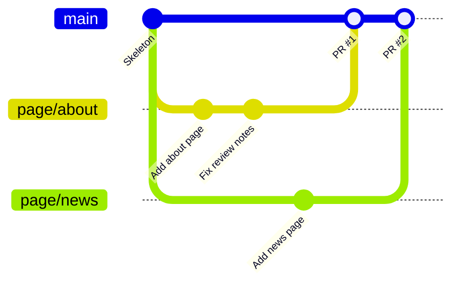

# Lab: Team pull requests on `website-restructure`

**Day 2 · Git & GitHub · continues from the GitHub remote lab (Day 1)**
**Team:** your table, 4 to 6 people · **Machine:** Debian 13, user `student`
**You need:** a GitHub account with your SSH key added (Day 1), and Git working in the terminal
**Time:** about 60 to 75 minutes

Your school is restructuring its website. One person in your team creates the repository, everyone else joins it as a collaborator, and each of you builds one page on your own branch. Nobody pushes straight to `main`. Every change goes through a **pull request** (PR) that a teammate reviews and approves before it is merged.

When you finish you will have:

- one shared GitHub repository, `website-restructure`, with your whole team as collaborators
- a `main` branch that GitHub protects, so changes only arrive through pull requests
- one branch, one pull request and one review per person
- a merged website with every teammate's page, and a history that shows who did what

---

## The big picture



Each person works on their own branch. A pull request asks: *please merge my branch into `main`*. A teammate reads the changes, comments, and approves. Only then does the branch join `main`.

Why work this way:

1. **`main` always works.** Half-finished pages stay on their branch until they are ready.
2. **Someone else reads every change.** Reviewers catch broken links, typos and the password someone forgot in a file.
3. **The history explains itself.** Each PR records what changed, why, who wrote it and who approved it.

---

## Step 0: Agree on roles

Sit with your table. Decide who is **Person 1, the owner**. The owner creates the repository and sets it up. Everyone else waits until Step 3.

Then give every person a page. Number yourselves around the table.

| Person | Role | Page | Branch name |
|---|---|---|---|
| 1 | Owner | `index.html` (home) and `css/style.css` | `page/home` |
| 2 | Member | `about.html` (history, mission, vision) | `page/about` |
| 3 | Member | `academics.html` (programs and subjects) | `page/academics` |
| 4 | Member | `admissions.html` (requirements, dates) | `page/admissions` |
| 5 | Member | `news.html` (three short news items) | `page/news` |
| 6 | Member | `contact.html` (address, phone, map link) | `page/contact` |

If your team has 4 or 5 people, skip the pages at the bottom of the table.

**Reviewer rule:** you review the PR of the person on your **right**. Person 6 (or the last person) reviews Person 1.

Each person edits **only their own file**. That way no two people change the same lines and nobody gets a merge conflict today. You will meet merge conflicts on Day 4.

---

## Step 1 (owner only): Create the repository

On GitHub, click **+** (top right) › **New repository**.

| Field | Value |
|---|---|
| Repository name | `website-restructure` |
| Visibility | **Public** |
| Add a README | **On** |
| .gitignore / license | leave empty |

Click **Create repository**.

> **Why public?** On a free GitHub account, the rule that protects `main` (Step 3) only works on public repositories. This is a practice site with no secrets in it, so public is fine.

Now clone it and add the starting files. Replace `OWNER` with your GitHub username.

```bash
cd ~/projects
git clone git@github.com:OWNER/website-restructure.git
cd website-restructure
mkdir css
```

Create `index.html`. It already links to every page, so members never have to edit it:

```bash
cat > index.html <<'EOF'
<!doctype html>
<html lang="en">
<head>
  <meta charset="utf-8">
  <meta name="viewport" content="width=device-width, initial-scale=1">
  <title>Home · Our School</title>
  <link rel="stylesheet" href="css/style.css">
</head>
<body>
  <nav>
    <a href="index.html">Home</a>
    <a href="about.html">About</a>
    <a href="academics.html">Academics</a>
    <a href="admissions.html">Admissions</a>
    <a href="news.html">News</a>
    <a href="contact.html">Contact</a>
  </nav>
  <main>
    <h1>Welcome to Our School</h1>
    <p>This site is being rebuilt by our team, one page at a time.</p>
  </main>
</body>
</html>
EOF
```

Create `page-template.html`. Every member copies this to start their page:

```bash
cat > page-template.html <<'EOF'
<!doctype html>
<html lang="en">
<head>
  <meta charset="utf-8">
  <meta name="viewport" content="width=device-width, initial-scale=1">
  <title>PAGE TITLE · Our School</title>
  <link rel="stylesheet" href="css/style.css">
</head>
<body>
  <nav>
    <a href="index.html">Home</a>
    <a href="about.html">About</a>
    <a href="academics.html">Academics</a>
    <a href="admissions.html">Admissions</a>
    <a href="news.html">News</a>
    <a href="contact.html">Contact</a>
  </nav>
  <main>
    <h1>PAGE TITLE</h1>
    <p>Write your content here.</p>
  </main>
  <footer>Page by YOUR NAME</footer>
</body>
</html>
EOF
```

And a simple stylesheet:

```bash
cat > css/style.css <<'EOF'
body   { font-family: sans-serif; margin: 0; line-height: 1.5; }
nav    { background: #1d3c78; padding: .8rem 1rem; }
nav a  { color: #fff; margin-right: 1rem; text-decoration: none; }
main   { max-width: 800px; margin: 2rem auto; padding: 0 1rem; }
footer { text-align: center; color: #777; padding: 2rem 0; font-size: .9rem; }
EOF
```

Commit and push straight to `main`. This is the **only** direct push to `main` in the whole lab:

```bash
git add .
git commit -m "Add site skeleton: home, template and stylesheet"
git push
```

Refresh the repository page on GitHub. You should see `index.html`, `page-template.html`, `css/` and `README.md`.

---

## Step 2 (owner only): Add your teammates as collaborators

1. In the repository, open **Settings** › **Collaborators** (left side, under *Access*).
2. GitHub may ask for your password or 2FA code again. That's normal for settings pages.
3. Click **Add people**, type a teammate's GitHub username, pick them from the list, and click **Add … to this repository**.
4. Repeat for every teammate.

Each teammate now shows as **Pending invite**.

> **Collaborator** means the person can push branches to your repository. On a personal repository, every collaborator gets write access. The protection rule in Step 3 is what stops them pushing to `main`.

---

## Step 3 (owner only): Protect `main`

1. **Settings** › **Rules** › **Rulesets** › **New ruleset** › **New branch ruleset**.
2. **Ruleset name:** `protect-main`
3. **Enforcement status:** **Active**
4. **Target branches:** **Add target** › **Include default branch**
5. Under *Branch rules*, make sure these are ticked:
   - **Restrict deletions**
   - **Require a pull request before merging**, and set **Required approvals** to **1**
   - **Block force pushes**
6. Click **Create**.

From now on, nobody can push to `main` directly, including you. Every change needs a PR with one approval.

> If your GitHub screen shows **Branches** › **Add classic branch protection rule** instead, use that: branch name pattern `main`, tick **Require a pull request before merging** and **Require approvals** (1), and save.

---

## Step 4 (members): Accept the invitation and clone

1. Accept the invitation. Use the email GitHub sent you, or the bell icon on GitHub, or go straight to `https://github.com/OWNER/website-restructure/invitations`.
2. Clone the repository:

```bash
cd ~/projects
git clone git@github.com:OWNER/website-restructure.git
cd website-restructure
ls
```

You should see the same files the owner pushed. The owner already has the clone from Step 1.

> **Owner:** check **Settings** › **Collaborators**. Nobody should still be *Pending*. A teammate who hasn't accepted can clone (the repo is public) but **can't push**.

---

## Step 5 (everyone): Make your branch

Start from an up-to-date `main`, then create your branch. Use the branch name from your row in the table.

```bash
git switch main
git pull
git switch -c page/about        # your own branch name
git branch                       # the * shows where you are
```

> **Branch names:** `page/about` says what kind of work it is and what it touches. Teams use prefixes like `feature/`, `fix/` and `docs/` the same way.

---

## Step 6 (everyone): Build your page

Members copy the template:

```bash
cp page-template.html about.html   # your own file name
```

Open it in VS Code (`code .`) and change:

- both `PAGE TITLE` placeholders
- the content inside `<main>`: at least one heading, two paragraphs and one list
- `YOUR NAME` in the footer

The owner (Person 1) improves `index.html` instead: a better welcome paragraph, a short "Quick links" list, and one change to `css/style.css`.

Open the page in a browser to check it:

```bash
xdg-open about.html
```

Make **at least two commits**, each with a clear message:

```bash
git add about.html
git commit -m "Add about page with history and mission"
# ... more edits ...
git add about.html
git commit -m "Add vision statement to about page"
git log --oneline
```

> **Using Claude Code?** It's fine to ask Claude to *check* your HTML: *"Check @about.html for broken tags and missing alt text. Explain only, don't change the file."* Write the content yourself; it's your school's page.

---

## Step 7 (everyone): Push your branch

```bash
git push -u origin page/about
```

`-u` links your local branch to the one on GitHub, so next time `git push` is enough.

**Optional: prove `main` is protected.** Try pushing to `main` directly and watch it fail:

```bash
git switch main
echo "sneaky" >> README.md
git commit -am "Try to skip review"
git push
```

GitHub rejects it with a message like:

```text
remote: error: GH013: Repository rule violations found for refs/heads/main.
remote: - Changes must be made through a pull request.
 ! [remote rejected] main -> main (push declined due to repository rule violations)
```

Undo that commit and go back to your branch:

```bash
git reset --hard origin/main
git switch page/about
```

---

## Step 8 (everyone): Open a pull request

1. Open the repository on GitHub. A yellow bar says **page/about had recent pushes**. Click **Compare & pull request**.
   (No yellow bar? Go to **Pull requests** › **New pull request**, choose **base: main** and **compare: page/about**.)
2. Check the arrow at the top: **base: `main`** ← **compare: `page/about`**.
3. **Title:** short and specific, for example `Add About page`.
4. **Description:** use this template:

```markdown
## What
Adds about.html with the school's history, mission and vision.

## How to check
1. Open about.html in a browser.
2. Click every link in the menu.

## Notes
The founding year (1964) needs to be confirmed by the registrar.
```

5. On the right, under **Reviewers**, pick the person on your right.
6. Click **Create pull request**.

> **Using Claude Code for the description:** *"Summarise the changes between main and my branch (`git diff main...HEAD`) as a PR description with What, How to check and Notes. Keep it under 10 lines."* Then read it and fix anything that isn't true.

Look at the PR page. It shows your commits, the files changed, and a box that says merging is **blocked** until there is an approving review. That's the rule from Step 3 working.

---

## Step 9 (everyone): Review a teammate's PR

You were picked as reviewer on the PR of the person on your left. Open **Pull requests** and find it.

1. Click the **Files changed** tab. Green lines are added, red lines are removed.
2. Hover over a line and click the blue **+** to comment on that line. Leave **at least one** useful comment, for example:
   - *"This link goes to `contact.htm`, the file is `contact.html`."*
   - *"The `` has no `alt` text."*
   - *"Typo: 'admision' → 'admission'."*
3. Click **Review changes** (or **Submit review**) and choose one:

| Choice | Use it when |
|---|---|
| **Comment** | Questions or small suggestions, no decision yet |
| **Request changes** | Something must be fixed before merging |
| **Approve** | You checked it and it's ready |

For this lab, the first review should be **Request changes** with at least one comment, so everyone practises fixing a PR.

**Good review comments** say what and where, and suggest a fix. "Looks bad" helps nobody. "The heading says Admisions; should be Admissions" does.

---

## Step 10 (everyone): Fix your PR after review

Read the comments on your own PR. Fix them **on the same branch**:

```bash
git switch page/about
# edit the file
git add about.html
git commit -m "Fix link and typo from review"
git push
```

Refresh the PR. The new commit appears in it automatically. You don't open a new PR.

Reply to each comment (for example, *"Fixed in the latest commit"*) and click **Resolve conversation**. Then, in the **Reviewers** list on the right, click the circular arrow next to your reviewer's name to ask them to look again.

**Reviewer:** check the new commit, then **Review changes** › **Approve** › **Submit review**.

---

## Step 11 (everyone): Merge

Once your PR has an approval, the merge box turns green.

1. Click **Merge pull request** › **Confirm merge**.
2. Click **Delete branch**. The branch's commits are now in `main`, so the branch isn't needed on GitHub any more.

Take turns, one merge at a time, and watch `index.html` start linking to real pages instead of 404s.

> **Who merges?** In this lab, the author merges after approval. Some teams let only the reviewer or a lead merge. The protection rule doesn't care, as long as there is an approval.

---

## Step 12 (everyone): Sync your PC with the new `main`

After all PRs are merged:

```bash
git switch main
git pull
git branch -d page/about     # delete your local branch, it's merged
ls                            # every teammate's page is here now
git log --oneline --graph
```

Open `index.html` in your browser and click through every page in the menu. Each one should load.

In the `git log --graph` output you can see each branch join `main` with a merge commit. On GitHub, open **Pull requests** › **Closed**: every PR is still there with its review and discussion.

---

## Troubleshooting

| You see | Cause and fix |
|---|---|
| `ERROR: Permission to OWNER/website-restructure.git denied to yourname.` | You haven't accepted the invitation yet. Do Step 4, part 1. |
| `GH013: Repository rule violations` or `GH006: Protected branch update failed` | You pushed to `main`. Push your branch instead: `git push -u origin page/about`. |
| `fatal: The current branch page/about has no upstream branch.` | First push of a new branch. Use `git push -u origin page/about`. |
| No **Compare & pull request** button | Use **Pull requests** › **New pull request** and choose your branch as *compare*. |
| Your reviewer isn't in the **Reviewers** list | They haven't accepted the invitation. |
| You can't approve your own PR | Correct. GitHub doesn't count the author's approval. Ask your reviewer. |
| **Merge** is grey: *Review required* | Wait for an approving review. Ping your reviewer. |
| The PR shows changes in files you didn't touch | You branched from an old `main`. Ask your trainer; this is the start of Day 4's rebase and merge topic. |
| `page-template.html` changed in your PR | You edited the template instead of your copy. Run `git restore --source=main page-template.html`, commit, push. |

---

## Check yourself

1. Why couldn't you push straight to `main` after Step 3?
2. After a reviewer asks for changes, do you open a new PR? What do you do instead?
3. What is the difference between a **collaborator** and a **reviewer**?
4. Why did each person get a different file in this lab?
5. Your teammate's PR is approved but you spot a bug after merging. What do you do? *(Hint: a new branch and a new PR.)*

---

## Cheat sheet

```bash
# start new work
git switch main
git pull
git switch -c page/your-page

# work
git add file.html
git commit -m "Clear message"

# share and open a PR
git push -u origin page/your-page     # first time
git push                               # after that, PR updates itself

# after merge
git switch main
git pull
git branch -d page/your-page
```

On GitHub: **Compare & pull request** › pick a reviewer › **Create pull request** › reviewer: **Files changed** › **Review changes** › **Approve** › author: **Merge pull request** › **Delete branch**.

---

## References

- GitHub Docs: [About pull requests](https://docs.github.com/en/pull-requests/collaborating-with-pull-requests/proposing-changes-to-your-work-with-pull-requests/about-pull-requests)
- GitHub Docs: [Inviting collaborators to a personal repository](https://docs.github.com/en/repositories/managing-your-repositorys-settings-and-features/repository-access-and-collaboration/inviting-collaborators-to-a-personal-repository)
- GitHub Docs: [About rulesets](https://docs.github.com/en/repositories/configuring-branches-and-merges-in-your-repository/managing-rulesets/about-rulesets)
- GitHub Docs: [Reviewing proposed changes in a pull request](https://docs.github.com/en/pull-requests/collaborating-with-pull-requests/reviewing-changes-in-pull-requests/reviewing-proposed-changes-in-a-pull-request)
